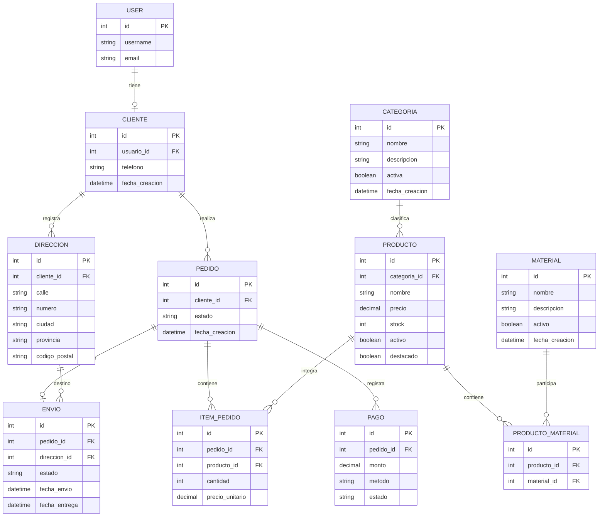

# Modelado de Base de Datos — Mueblería Arboleda

## 1. Introducción

El sistema de Mueblería Arboleda utiliza una base de datos relacional gestionada mediante el ORM de Django.

El diseño está compuesto por 10 modelos propios, distribuidos en tres aplicaciones: `catalogo`, `clientes` y `ventas`.

El objetivo del modelado es representar los productos comercializados, sus categorías y materiales, los datos de los clientes y las operaciones relacionadas con pedidos, pagos y envíos.

Se utiliza SQLite como motor de base de datos durante el desarrollo.

## 2. Distribución de modelos

### Aplicación catalogo

- **Categoria:** clasifica los productos disponibles.
- **Material:** representa los materiales utilizados para fabricar los productos.
- **Producto:** almacena información comercial, precio, stock y categoría.
- **ProductoMaterial:** representa la relación entre productos y materiales.

### Aplicación clientes

- **Cliente:** representa el perfil comercial de un usuario registrado en Django.
- **Direccion:** almacena las direcciones asociadas a cada cliente.

### Aplicación ventas

- **Pedido:** representa una compra realizada por un cliente.
- **ItemPedido:** registra los productos, cantidades y precios de cada pedido.
- **Pago:** registra los pagos asociados a los pedidos.
- **Envio:** representa la información de envío de un pedido.

## 3. Diagrama de relaciones



**Nota:** `USER` representa el modelo `auth.User` proporcionado por Django. Se incluye para visualizar su relación con `Cliente`, pero no forma parte de los 10 modelos propios del proyecto. El diagrama resume los campos principales; las definiciones completas se encuentran en `models.py`.

## 4. Relaciones principales

| Origen | Destino | Relación |
|---|---|---|
| User | Cliente | Uno a uno |
| Cliente | Direccion | Uno a muchos |
| Cliente | Pedido | Uno a muchos |
| Categoria | Producto | Uno a muchos |
| Producto | Material | Muchos a muchos mediante ProductoMaterial |
| Pedido | ItemPedido | Uno a muchos |
| Producto | ItemPedido | Uno a muchos |
| Pedido | Pago | Uno a muchos |
| Pedido | Envio | Uno a uno |
| Direccion | Envio | Uno a muchos |

Las relaciones se implementan utilizando `ForeignKey`, `OneToOneField` y `ManyToManyField` del ORM de Django.

## 5. Reglas y restricciones

Las siguientes restricciones están implementadas en los modelos:

- El nombre de cada categoría y material debe ser único.
- Cada usuario de Django puede estar asociado como máximo a un perfil de cliente.
- Cada producto pertenece a una categoría.
- Un producto puede tener múltiples materiales y un material puede utilizarse en múltiples productos.
- La combinación de producto y material no puede repetirse en `ProductoMaterial`.
- Los precios de los productos no pueden ser negativos.
- La cantidad de un ítem de pedido debe ser como mínimo 1.
- El precio unitario de un ítem no puede ser negativo.
- El monto de un pago debe ser mayor que cero.
- Cada envío está asociado a un único pedido.
- Los pedidos, pagos y envíos utilizan estados definidos para representar su situación.

También se utilizan políticas de eliminación como `CASCADE` y `PROTECT`, según la relación, para preservar la integridad de los datos.

## 6. Implementación con Django

Cada aplicación define sus modelos en `models.py`, y Django genera las migraciones necesarias para crear o modificar las tablas de la base de datos.

Las migraciones se administran mediante:

```bash
uv run python manage.py makemigrations
uv run python manage.py migrate
```

El diseño utiliza relaciones entre aplicaciones para conectar el catálogo, los clientes y las operaciones de ventas.

## 7. Conclusión

El modelo relacional de Mueblería Arboleda permite organizar los datos de forma estructurada y mantener las relaciones necesarias para gestionar el catálogo, los clientes, los pedidos, los pagos y los envíos.

La separación en tres aplicaciones facilita el mantenimiento del código y el desarrollo colaborativo. Además, el ORM de Django permite acceder a los datos relacionados sin necesidad de escribir directamente las consultas SQL.
